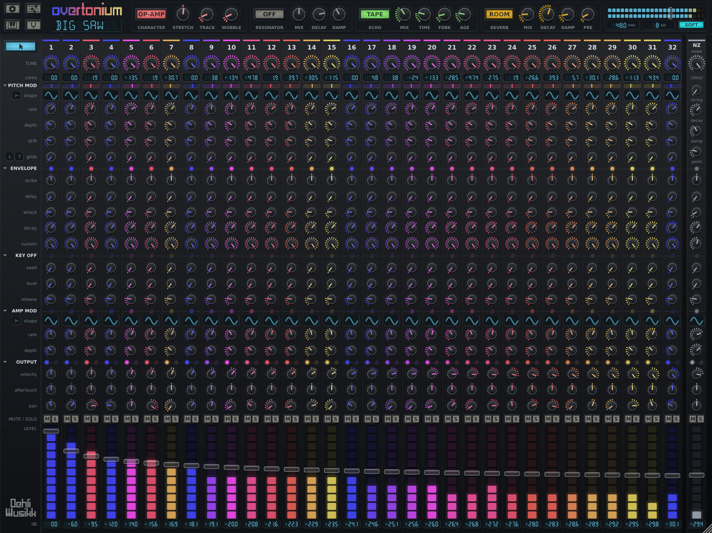
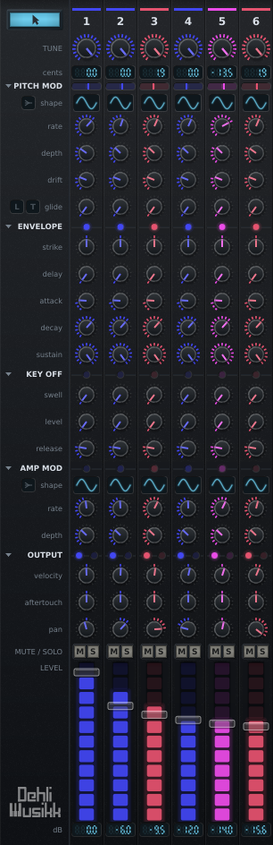

# Overtonium

A 32-partial additive synthesizer laid out like a 32-channel mixer. Each channel is one sine oscillator locked to a harmonic of the note you play, and each channel has its own tuning, envelope and modulation.

Start with TUNE. It sweeps each partial continuously between equal temperament and just intonation. At the just end, each partial sits at an exact integer ratio with the fundamental, and the whole stack blends into a single timbre. At the equal end, each partial moves to the nearest 12-TET semitone, and the same stack spreads out into a chord. The factory presets _Just Saw_ and _Equal Saw_ differ only in that one control, and they sound nothing alike.



[](https://github.com/benjamindehli/overtonium/actions/workflows/build.yml)

- **Formats:** VST3, AU (macOS), Standalone, LV2 (Linux)
- **Platforms:** macOS (universal), Windows, Linux
- **Framework:** JUCE 9
- **Licence:** AGPLv3. See [Licensing](#licensing)
- **Page:** [benjamindehli.github.io/overtonium](https://benjamindehli.github.io/overtonium/), built from `docs/`
- **Listed at:** [KVR Audio](https://www.kvraudio.com/product/overtonium-by-dehli-musikk)
- **By:** Benjamin Dehli for Dehli Musikk. Hosts list it under DehliMusikk (manufacturer code `Dhmk`, plugin code `Ovtn`)
- **Also here:** [design notes](DESIGN.md), [contributing](CONTRIBUTING.md), [architecture](ARCHITECTURE.md), [accessibility](ACCESSIBILITY.md), [security policy](SECURITY.md), [code of conduct](CODE_OF_CONDUCT.md)

On every push, CI builds all three platforms and runs the test suite on each of them. macOS is the only platform where the plugin has been loaded into a host. There, the Audio Unit and the VST3 pass `auval` and pluginval at strictness 8. Nobody has run the Windows or Linux builds in a DAW yet, so treat those as untried and please report what you find.

## Background

This is the fourth instrument in a series, and the first that generates its sound instead of playing back samples. It is built on two ideas. Both came from sitting at a drawbar organ, and neither is really about organs.

[Voltage Controlled Cassette Organ](https://github.com/benjamindehli/VoltageControlledCassetteOrgan) came first, in 2023. It is a Korg CX-3 sampled through cassette tape, with every note of every drawbar recorded as its own file. The tape was the reason for it. Wow, flutter and random warbles gave the organ a movement like a chorus or a rotary speaker, without the fixed rate of a modulation effect. It was recorded to tape twice, which doubled it. No tape deck plays back the same way twice, so the two passes never quite matched.

[Strykebrett](https://github.com/benjamindehli/Strykebrett) came in October of the same year. It is a sampled Logan String Melody II. It has six faders instead of nine drawbars, each setting the level of one octave or one of the voices across a bass and a treble section, and four of them have their own envelope and LFO. It is not an organ, and that is what makes it useful here: it showed that the workflow still works on a different instrument.

[EDB-Orgel](https://github.com/benjamindehli/EDB-Orgel) followed in 2024. It keeps the drawbar workflow and puts four digital synthesis types under it instead of an organ.

All three gave each drawbar its own envelope and LFO, and that is the first of the two ideas. A drawbar is a partial, and on an organ you move them by hand while the note sounds. Nine of them shaped separately already sounds unlike an organ. Thirty-two, each with a full channel of controls, takes that idea as far as it goes.

The second idea is about how the drawbars are tuned. A drawbar is a harmonic, but an organ only has the twelve notes of the keyboard to build it from, so each drawbar is set to the nearest one. The second, fifth and eighth are all fifths an octave apart, so holding a C puts three G's into the sound. A real harmonic series is different. Its intervals are whole-number ratios, 2:1, 3:2, 4:3, and apart from the octaves none of them lands on a key. TUNE turns that difference into a control. This only works because the partials are computed. A sampled partial is stuck at the pitch it was recorded at. A computed one can sit where the organ would put it, at its exact ratio, or anywhere between.

The earlier instruments also show up in the details. DRIFT is the cassette's random warble, one per partial. WOBBLE is the same thing applied to the whole instrument. The tape echo has two paths, each with its own motor speed and its own random stream, and they are the double tracking. `TapeEcho::kMinAge` exists for the same reason the two tape passes never matched. A transport that held its speed exactly would put the repeat back in mono, and no real transport does that.

All three earlier instruments are sample libraries with a plugin wrapper, sold at [Dehli Musikk](https://store.dehlimusikk.no/). This one is free software, and it contains none of their code.

The Adaptive temperament follows the Norwegian composer Eivind Groven, who from 1936 built organs with up to three pitches for every key, chosen automatically as the music moved, so an ordinary keyboard could play pure chords in every key. It relies on another project of mine, [music-utils](https://github.com/benjamindehli/music-utils), a library that names chords from the MIDI notes held. The temperament is tested against its list of 125 chord types. Every one, in all twelve keys, has to sound the same however it is played, and be as pure as possible.

## What is in it

Each channel is a strip, and each strip has the same twenty-three controls. The captions are listed once down the left instead of repeated across all thirty-three, and each channel is coloured by its interval against the fundamental.



Start with the [project page](https://benjamindehli.github.io/overtonium/). It has a page for each main part:

- **[Tuning](https://benjamindehli.github.io/overtonium/tuning/)**: TUNE from equal to just, inharmonic stretch, six historical temperaments and an adaptive one on any root, keyboard tracking and per-partial drift
- **[Controls](https://benjamindehli.github.io/overtonium/controls/)**: every knob on a channel strip, the two-part envelope, LINK for ganging the series, the lamps and meters, and the noise channel with its Karplus-Strong string
- **[Effects](https://benjamindehli.github.io/overtonium/effects/)**: the bar above the mixer, from the oscillator character, the wobble and the resonator of 88 Karplus-Strong sympathetic strings through the echo, the reverb and the converter to the five CLIP shapes on the output
- **[Playing](https://benjamindehli.github.io/overtonium/playing/)**: MPE, legato and glide, the Settings menu, automation with every parameter listed, macros and MIDI Learn
- **[Presets](https://benjamindehli.github.io/overtonium/presets/)**: the thirty-five that ship, what a preset stores and deliberately leaves out, switching them with a MIDI program change, and where your own are saved
- **[Install](https://benjamindehli.github.io/overtonium/install/)**: which download to choose, what to do when a host cannot see the plugin, and building from source

[DESIGN.md](DESIGN.md) covers the same ground in more detail, with the reasoning: what each part does, what the alternatives cost, and the measurements behind the numbers.

## Building and contributing

You need CMake 3.22 or newer and a C++17 compiler. JUCE is downloaded at configure time.

```sh
cmake -B build -DCMAKE_BUILD_TYPE=Release
cmake --build build
```

That build treats warnings as errors, the same as CI. If your compiler is one this project has not been tested with, add `-DOVERTONIUM_WARNINGS_AS_ERRORS=OFF` and it builds anyway.

[CONTRIBUTING.md](CONTRIBUTING.md) has the rest: notes for each platform, the two test suites, formatting, warnings as errors, how a release is made and how the project page is served. [ARCHITECTURE.md](ARCHITECTURE.md) describes how the code is organised.

## Checking for updates

The update check is off unless you turn it on. The first time an editor opens, a dialog asks whether to turn it on, and nothing goes to the network unless you say yes. Your answer is remembered, so you are not asked again, and after that the setting is under Settings.

When it is on, a background thread fetches `docs/latest.json` from the project page and compares its version with this build. If the file names a newer version, a dialog tells you once for that release, SETTINGS lights up, and the first item in its menu opens the release page. It is a plain GET for one small static file. It sends no identifier, no version and nothing about your machine, and it goes to the same server that hosts the documentation.

The preference is kept in a settings file next to the presets, not in the plugin's state. It belongs to you, not to a patch. If it were stored in the state, every new instance would ask again, and a host scanning its plugin folder creates dozens of them.

The dialogs are drawn inside the editor, not opened as separate windows. A plugin cannot tell the difference between someone opening it and a host scanning at startup, and a window that waited for an answer would stop the scan. These dialogs do not wait. A question is only marked as asked once it has been answered, so an editor opened by a scan does not use it up.

The release workflow rewrites `docs/latest.json` as part of publishing. So the feed can never name a version that was not released, and never falls behind one that was.

## Licensing

Overtonium is released under the [AGPLv3](LICENSE).

This follows from what it is built on. The JUCE framework modules are dual-licensed under the AGPLv3 or a paid commercial licence. A plugin forms a single combined work with them, so the combination has to be conveyed under terms the AGPL allows. Using the AGPL for this project too is the simplest way to do exactly that. The AGPL's network clause, section 13, only applies to software that people use remotely over a network. An audio plugin is not that, so in practice it works like the GPL.

If you want to build on this and release something closed-source, you need a commercial JUCE licence from JUCE and a separate agreement for this project, because the AGPL does not allow it.

There is no splash screen to worry about. JUCE 6 and 7 had one, and turning it off required a paid licence. JUCE 8 removed it, and if you define `JUCE_DISPLAY_SPLASH_SCREEN` it is ignored with a compiler warning.
